# Awesome AI API Cost Tracking & Token Metrics 🪙⚡

<p align="center">
  
</p>

<p align="center">
  <a href="https://github.com/ishandutta2007/Awesome-Awesome-Awesome"></a>
  <a href="https://discord.gg/jc4xtF58Ve"></a>
  <a href="https://github.com/ishandutta2007/Awesome-AI-API-Cost-Tracking-Token-Metrics/stargazers"></a>
  <a href="https://github.com/ishandutta2007/Awesome-AI-API-Cost-Tracking-Token-Metrics/network/members"></a>
  <a href="https://github.com/ishandutta2007/Awesome-AI-API-Cost-Tracking-Token-Metrics/issues"></a>
  <a href="https://github.com/ishandutta2007/Awesome-AI-API-Cost-Tracking-Token-Metrics/blob/main/LICENSE"></a>
  <a href="https://github.com/ishandutta2007"></a>
</p>

<p align="center">
  <strong>Curated Directory of Top AI API Cost Tracking Platforms, LLM Gateways, Token Telemetry Tools, Coding-Agent Quota Monitors &amp; FinOps for AI</strong><br>
  <em>Monitoring spend, prompt/completion token velocity, virtual key budget limits, semantic caching &amp; model routing.</em>
</p>

---

## 📖 Table of Contents

- [🌟 Sector Overview & Market Dynamics](#-sector-overview--market-dynamics)
- [🏢 SaaS & Hosted Platforms](#-saas--hosted-platforms)
- [💻 Open-Source GitHub Projects](#-open-source-github-projects)
  - [Open-Source Standalone Observability & Gateways (Ranked by Stars)](#-open-source-standalone-observability--gateways-ranked-by-stars)
  - [Local Coding-Agent Quota & CLI Usage Monitors](#-local-coding-agent-quota--cli-usage-monitors)
  - [Token Calculators, Caching & Routing Utilities](#-token-calculators-caching--routing-utilities)
- [🛠️ Recommended Architecture Blueprints](#-recommended-architecture-blueprints)
- [🤝 How to Contribute](#-how-to-contribute)
- [💖 Support & Sponsorship](#-support--sponsorship)
- [📈 Star History](#-star-history)
- [📜 Disclaimer](#-disclaimer)

---

## 🌟 Sector Overview & Market Dynamics

The global **AI Observability and AI FinOps market** is expanding at unprecedented velocity, estimated at **$2.6B to $3.4B in 2026** for dedicated AI telemetry/model monitoring and surging toward **$17B+** when coupled with the broader cloud cost governance and FinOps sector.

Market dynamics currently reflect a **moderately fragmented yet rapidly consolidating landscape** rather than a strict winner-take-all monopoly:
- **Cloud Infrastructure Titans & APM Giants** (Cloudflare, Datadog, Dynatrace) leverage massive enterprise distribution and deep balance sheets to roll AI telemetry directly into existing observability stacks.
- **Fast-Moving AI-Native Startups** (LangSmith/LangChain, Portkey, Helicone, LiteLLM) lead developer mindshare through open-source gateways, sub-millisecond edge proxies, and specialized multi-agent session trace tools.
- Recent high-profile exits—such as **Dynatrace acquiring Arize AI for $915M**, **Palo Alto Networks acquiring Portkey (~$140M)**, and **Mintlify acquiring Helicone**—signal an aggressive wave of platform consolidation as major security and APM vendors absorb specialized AI FinOps players.

---

## 🏢 SaaS & Hosted Platforms

A comprehensive comparison of top commercial and hosted platforms for tracking LLM token burn, enforcing enterprise quota budgets, routing model prompts, and monitoring agent traces.

| Platform | Company Size (Valuation / Revenue) | Pricing (Paid Tiers) | Free Tier / Trial Limits | Description |
| :--- | :--- | :--- | :--- | :--- |
| **[Cloudflare AI Gateway](https://cloudflare.com)** | **~$68.7B Market Cap** ($2.17B FY25 Revenue) | $0 edge gateway fee on Free/BYOK; Workers Paid starts at **$5/month** (Unified Billing adds 5% credit processing fee) | **Free Forever plan**: Capped at 10 gateways, 100,000 total stored logs across account, 25 MB max cacheable request size, and 200 req/60s rate limit on unified billing. | Managed edge proxy sitting between applications and AI providers to deliver unified request analytics, token/cost estimation, response caching, and rate limiting. |
| **[Datadog LLM Observability](https://datadoghq.com)** | **~$48.5B Market Cap** ($3.43B FY25 Revenue) | Pro tier starts at **$160/month** (includes 100,000 LLM spans; additional spans billed in blocks) | **Free Forever plan**: 40,000 LLM spans/month with 15-day data retention; also offers a **14-day free trial** with full access to the observability suite. | Enterprise cloud monitoring solution tracking end-to-end LLM and agent traces, token consumption, operational spend, latency bottlenecks, and drift metrics. |
| **[LangSmith (LangChain)](https://langchain.com)** | **$3.0B Valuation** ($460M raised) | Plus plan starts at **$39/seat/month** (includes 10,000 base traces/month shared; overages at ~$2.50 per 1,000 traces) | **Developer Free Forever plan**: 1 seat, up to 5,000 traces/month, 14-day data retention, 10 dataset rows per dataset. | Enterprise AI engineering and observability platform by LangChain offering trace-level token accounting, run evaluations, prompt playground, and cost tracking. |
| **[Martian](https://withmartian.com)** | **~$1.3B Valuation** ($30M+ raised) | Usage routing fees starting at **$20 per 5,000 requests** or **$0.05/M tokens routed** on top of underlying model token costs; Enterprise custom contracts | **Case-by-case developer credit allocation**: Requires account signup and dashboard credit provisioning (no permanent self-serve free tier; promotional hackathon/research credits granted). | Model-routing and cost-optimization API platform that dynamically routes prompts to the most cost-effective LLM capable of meeting quality thresholds. |
| **[Arize AX](https://arize.com)** | **$915M Valuation** (Acquired by Dynatrace for $915M; $131M raised) | AX Pro starts at **$50/month** (50,000 spans/mo, 10 GB ingestion, 30-day retention; overage billing enabled) | **Free Forever plan**: 25,000 trace spans/month, 1 GB storage ingestion/month, 15-day data retention, 1 space, and 10 Signal issues/month. | Enterprise AI observability, evaluation, and tracing platform providing granular token accounting, cache-read/write token metrics, and cost anomaly alerts. |
| **[Portkey](https://portkey.ai)** | **~$140M Valuation** (Acquired by Palo Alto Networks; $18M+ raised) | Production plan starts at **$49/month** (includes 100,000 recorded logs/month with 30-day retention; overages at $9 per 100k requests) | **Developer Free Forever plan**: 10,000 recorded logs/month, 3-day log retention, 30-day metrics retention; requests beyond 10k continue routing without interruption (unlogged). | Enterprise AI gateway and observability suite featuring virtual API keys, granular budget caps, automatic fallback routing, semantic caching, and real-time cost dashboards. |
| **[Helicone](https://helicone.ai)** | **$25M Valuation** (Acquired by Mintlify; $5M Seed raised) | Pro plan starts at **$79/month** (+ usage-based overages; includes unlimited seats, 1-month retention); Team tier at $799/month | **Hobby Free Forever plan**: 10,000 requests/month, 1 GB storage, 7-day data retention, 1 seat, 1 organization, and rate limit of 10 logs/minute. | Proxy-based LLM observability and FinOps platform providing real-time token metering, per-user/property cost attribution, semantic caching, and custom rate-limit alerts. |
| **[PromptLayer](https://promptlayer.com)** | **~$4.8M Funding Raised** (ScOp & Stellation Capital Seed) | Pro plan starts at **$49/month** (unlimited workspaces and playgrounds, 150 MB dataset storage; overage at $0.003/transaction) | **Free Forever plan**: Up to 5 users, 2,500 requests/month, 1 workspace, 250 evaluation executions/month, 10 MB dataset storage, and 10 prompt templates. | Prompt management and LLM analytics platform providing request history logging, token-per-template cost breakdowns, latency tracking, and A/B test evaluations. |
| **[Keywords AI (Respan)](https://keywordsai.co)** | **Seed-funded** (Y Combinator W24) | Team plan starts at **$199/month** (higher proxy throughput ~8,400 req/min; optional HIPAA add-on at $500/month; overages at $8 per 100k logs) | **Free Forever plan**: $0/month with starter volume of up to 100,000 logs, 30-day log retention, up to 2 team seats, and 10 prompt template versions. | Unified LLM gateway and monitoring platform offering a single OpenAI-compatible endpoint with token analytics, latency metrics, user-level spend limits, and caching. |

---

## 💻 Open-Source GitHub Projects

All open-source tools are sorted descending by GitHub star popularity. Each project includes a real-time Stars_Badge linking to its stargazer community.

### 🚀 Open-Source Standalone Observability & Gateways (Ranked by Stars)

1. **[ollama/ollama](https://github.com/ollama/ollama)** [](https://github.com/ollama/ollama/stargazers) 🦙  
   Get up and running with Llama, Mistral, Gemma, DeepSeek, and other open-source models locally or on private servers. Eliminates third-party token costs entirely with built-in inference APIs and telemetry hooks.

2. **[vllm-project/vllm](https://github.com/vllm-project/vllm)** [](https://github.com/vllm-project/vllm/stargazers) ⚡  
   High-throughput, memory-efficient LLM serving engine featuring PagedAttention and native Prometheus metrics exporting input/output token counts, KV cache utilization, and throughput analytics.

3. **[BerriAI/litellm](https://github.com/BerriAI/litellm)** [](https://github.com/BerriAI/litellm/stargazers) 🛡️  
   The fastest, lightest AI Gateway and Python SDK (`MIT`). Unified OpenAI-compatible proxy across 100+ LLMs with virtual key management, user/team budget caps, rate limiting, and real-time spend attribution across AWS Bedrock, Azure, OpenAI, and Anthropic.

4. **[Calcium-Ion/new-api](https://github.com/Calcium-Ion/new-api)** [](https://github.com/Calcium-Ion/new-api/stargazers) 🌐  
   Feature-rich self-hosted LLM gateway and API distributor supporting OpenAI, Claude, and Gemini formats with intelligent model routing, granular user token quotas, and comprehensive cost accounting dashboards.

5. **[langfuse/langfuse](https://github.com/langfuse/langfuse)** [](https://github.com/langfuse/langfuse/stargazers) 🪢  
   Open-source AI engineering and observability platform (`MIT`). Offers automated model pricing tables, hierarchical trace/session cost aggregation, prompt versioning, and OpenTelemetry instrumentation.

6. **[songquanpeng/one-api](https://github.com/songquanpeng/one-api)** [](https://github.com/songquanpeng/one-api/stargazers) 🔑  
   Popular open-source multi-provider LLM API key aggregation and distribution platform with token quota controls, billing management, user groups, and single-binary Docker deployment.

7. **[promptfoo/promptfoo](https://github.com/promptfoo/promptfoo)** [](https://github.com/promptfoo/promptfoo/stargazers) 🎯  
   CLI and CI/CD security and quality evaluation tool for LLMs and agents. Benchmarks output quality, vulnerability vectors, latency, and cost-per-prompt tradeoffs across GPT, Claude, Gemini, and DeepSeek.

8. **[comet-ml/opik](https://github.com/comet-ml/opik)** [](https://github.com/comet-ml/opik/stargazers) 📊  
   Production-ready open-source LLM evaluation, tracing, and monitoring platform by Comet. Tracks trace-level token consumption, latency distribution, and cost attribution with built-in dashboards.

9. **[Portkey-AI/gateway](https://github.com/Portkey-AI/gateway)** [](https://github.com/Portkey-AI/gateway/stargazers) 🚀  
   Ultra-fast, production-tested AI gateway written in TypeScript (`MIT`). Supports 1,600+ models, 50+ guardrails, automatic fallbacks, semantic caching, and streaming token metrics with under 1ms overhead.

10. **[tensorzero/tensorzero](https://github.com/tensorzero/tensorzero)** [](https://github.com/tensorzero/tensorzero/stargazers) 🦀  
    Industrial-grade LLM gateway and observability engine built in Rust (`Apache-2.0`). Employs ClickHouse for real-time token tracking, dynamic model optimization, fallback routing, and A/B evaluations.

11. **[maximhq/bifrost](https://github.com/maximhq/bifrost)** [](https://github.com/maximhq/bifrost/stargazers) 🌈  
    High-throughput Go-based AI gateway adding under 200µs of overhead at 5k RPS. Provides virtual keys, budget enforcement, load balancing, semantic caching, and OpenTelemetry token telemetry.

12. **[traceloop/openllmetry](https://github.com/traceloop/openllmetry)** [](https://github.com/traceloop/openllmetry/stargazers) 📡  
    OpenTelemetry instrumentation SDK (`Apache-2.0`) for LLM frameworks (LangChain, LlamaIndex, OpenAI). Standardizes token metrics (`gen_ai.usage.input_tokens`, `output_tokens`) for Prometheus, Grafana, and Datadog.

13. **[Helicone/helicone](https://github.com/Helicone/helicone)** [](https://github.com/Helicone/helicone/stargazers) 🧊  
    Open-source AI gateway and observability proxy (`Apache-2.0`). Enables self-hosted request logging, user-level token and cost metrics, semantic prompt caching, and custom alert webhooks.

14. **[openlit/openlit](https://github.com/openlit/openlit)** [](https://github.com/openlit/openlit/stargazers) 📉  
    Zero-code OpenTelemetry-native GenAI & LLM observability and FinOps platform (`Apache-2.0`). Monitors prompt/completion tokens, GPU hardware metrics, and calculates real-time USD costs across providers.

15. **[bricks-cloud/BricksLLM](https://github.com/bricks-cloud/BricksLLM)** [](https://github.com/bricks-cloud/BricksLLM/stargazers) 🧱  
    Enterprise-grade cloud-native API gateway written in Go that helps DevOps teams monitor and impose hard spending limits, cost rate ceilings, and RBAC policies per API key.

---

### 🖥️ Local Coding-Agent Quota & CLI Usage Monitors

1. **[ryoppippi/ccusage](https://github.com/ryoppippi/ccusage)** [](https://github.com/ryoppippi/ccusage/stargazers) ⏱️  
   High-speed CLI tool (`npx ccusage`) for parsing local Claude Code JSONL logs. Summarizes daily/monthly prompt and completion token usage, cache creation/read savings, and equivalent API spend.

2. **[Maciek-roboblog/Claude-Code-Usage-Monitor](https://github.com/Maciek-roboblog/Claude-Code-Usage-Monitor)** [](https://github.com/Maciek-roboblog/Claude-Code-Usage-Monitor/stargazers) 🚨  
   Real-time terminal dashboard tracking Claude Code token burn velocity, session reset countdowns, quota utilization percentages, and proactive limit warnings.

3. **[phuryn/claude-usage](https://github.com/phuryn/claude-usage)** [](https://github.com/phuryn/claude-usage/stargazers) 🍏  
   Native macOS menu-bar utility and terminal monitor designed to track Claude Code token usage, 5-hour rolling burn rates, weekly subscription limits, and session cost attribution.

---

### 🧮 Token Calculators, Caching & Routing Utilities

1. **[openai/tiktoken](https://github.com/openai/tiktoken)** [](https://github.com/openai/tiktoken/stargazers) 🔢  
   Fast open-source BPE tokenizer library from OpenAI (`MIT`). Fundamental building block for pre-flight token counting, context-window budgeting, and estimating prompt pricing.

2. **[zilliztech/GPTCache](https://github.com/zilliztech/GPTCache)** [](https://github.com/zilliztech/GPTCache/stargazers) 🧠  
   Semantic caching library for LLMs (`MIT`). Intercepts semantically identical or similar prompts and serves cached completions to slash API token burn by 30%–80%.

3. **[lm-sys/RouteLLM](https://github.com/lm-sys/RouteLLM)** [](https://github.com/lm-sys/RouteLLM/stargazers) 🔀  
   Open-source model-routing framework developed by LMSYS (`Apache-2.0`). Dynamically directs simple tasks to cheaper SLMs and complex reasoning to flagship LLMs, drastically lowering total inference expenditure.

4. **[AgentOps-AI/tokencost](https://github.com/AgentOps-AI/tokencost)** [](https://github.com/AgentOps-AI/tokencost/stargazers) 💵  
   Lightweight Python library (`MIT`) providing programmatic USD price lookups and token calculations across 400+ commercial and open LLM models.

---

## 🛠️ Recommended Architecture Blueprints

To build a zero-leakage enterprise AI cost management system, combine best-of-breed open-source and hosted tools:

```
[Applications / Coding Agents / Developers]
                     │
                     ▼
  ┌────────────────────────────────────────────────────────┐
  │  ⚡ AI Gateway (LiteLLM / Portkey / Bifrost / New-API)   │  ◄── Enforces Team Budgets & Rate Caps
  └──────────────────┬─────────────────────────────────────┘
                     │
         ┌───────────┴───────────┐
         ▼                       ▼
┌──────────────────┐    ┌──────────────────────────────────┐
│ 🧠 Semantic Cache │    │ 🔀 Model Router (RouteLLM)       │  ◄── Deduplicates Queries & Optimizes Spend
└──────────────────┘    └────────┬─────────────────────────┘
                                 │
                                 ▼
                     ┌───────────────────────┐
                     │ External AI Providers │ (OpenAI, Anthropic, Bedrock, vLLM)
                     └───────────┬───────────┘
                                 │
                                 ▼
  ┌────────────────────────────────────────────────────────┐
  │ 📊 FinOps Telemetry (Langfuse / OpenLIT / OpenLLMetry)  │  ◄── Attribution by User, Team, & Model
  └────────────────────────────────────────────────────────┘
```

---

## 🤝 How to Contribute

Contributions are welcome from AI engineers, FinOps practitioners, and open-source contributors!

1. 🍴 Fork the repository.
2. 🌿 Create a descriptive feature branch (`git checkout -b add-tool-name`).
3. 📝 Add or update entries in `README.md` following the existing format:
   - For SaaS: include pricing starting tiers, free-tier limits, company valuation/revenue, and description.
   - For Open-Source: include repo link, description, and social Stars_Badge.
4. 🚀 Open a Pull Request with a clear explanation of the tool and verification links.

---

## 💖 Support & Sponsorship

If this curated repository saved your team cloud token spend, helped streamline your AI FinOps pipelines, or introduced you to great developer tools, please consider supporting the project:

- ⭐ **Star this repository** to help others discover it on GitHub.
- 🍴 **Fork & Share** with your colleagues, platform engineering teams, and Discord communities.
- ☕ **Buy me a coffee**: Sponsor ongoing research and curation via the [GitHub Sponsor Dashboard](https://github.com/sponsors/ishandutta2007).

---

## 📈 Star History

[](https://www.star-history.com/#ishandutta2007/Awesome-AI-API-Cost-Tracking-Token-Metrics&type=date&legend=top-left)

---

## 📜 Disclaimer

- This list is **community-curated** for informational purposes and does not constitute formal endorsement.
- LLM provider pricing, prompt-caching multipliers (`cache_read` / `cache_creation`), reasoning-token billing rules, and free-tier quotas fluctuate frequently. Always verify live pricing tables before implementing enterprise billing chargebacks.
